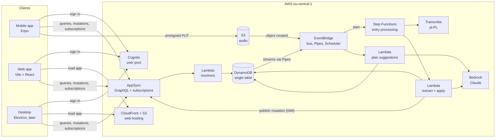

# Architecture

This page gives the overview. Each decision and its alternatives are in the [ADRs](adr/README.md).

## System context

## Main flows

### Dictation (ADR-0007, ADR-0008)

1. Mobile calls `createEntryUpload` and uploads audio to S3 with a presigned URL.
2. EventBridge starts the Step Functions workflow for the entry.
3. Transcribe produces the transcript. A Lambda sends it with project context to Bedrock.
4. Bedrock returns a change set proposal that matches the schema. Code validates it.
5. Confident, safe operations are applied in one DynamoDB transaction; the rest wait for review.
6. Each status change is published through AppSync. Web and mobile update in real time.

### Daily plan (ADR-0009, ADR-0013)

1. The user adds plan items manually or by voice. Template routines add recurring items.
2. After an evening summary, or by the morning schedule, a Lambda asks Bedrock for plan suggestions.
3. Suggestions stay pending until the user accepts or edits them.

### Sign-in (ADR-0004)

All clients use the same Cognito user pool through Amplify Auth with the SRP flow. AppSync authorizes every request with the user's token, and every resolver checks project ownership.

## Repository layout

See [ADR-0001](adr/0001-monorepo-pnpm-turborepo.md).

## Environments

| Environment | Web app | Deployed from | Purpose |
|---|---|---|---|
| `dev` | `dev.talktally.tybu.com` | every merge to `main` | integration, end-to-end and device tests, work in progress |
| `prod` | `talktally.tybu.com` | release tag with manual approval | public demo |

Both environments live in one AWS account, separated by resource name prefixes ([ADR-0003](adr/0003-terraform-infrastructure-as-code.md)).

## Cross-cutting concerns

- **Security:** least-privilege IAM per function, OIDC for CI, invite-only sign-up, owner checks in every resolver and subscription, no secrets in the repository.
- **Cost:** pay-per-request services only, budgets and anomaly alerts, quotas per user ([ADR-0002](adr/0002-serverless-aws-and-cost-guardrails.md)).
- **Observability:** structured JSON logs, X-Ray tracing across AppSync, Lambda and Step Functions, a CloudWatch dashboard and alarms for pipeline failures.
